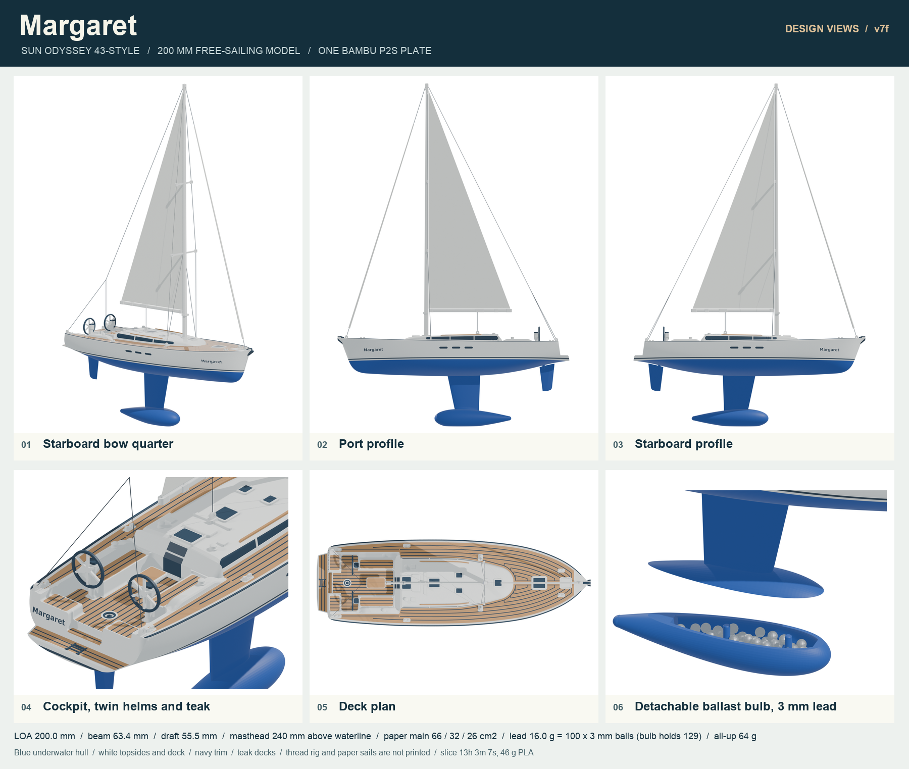
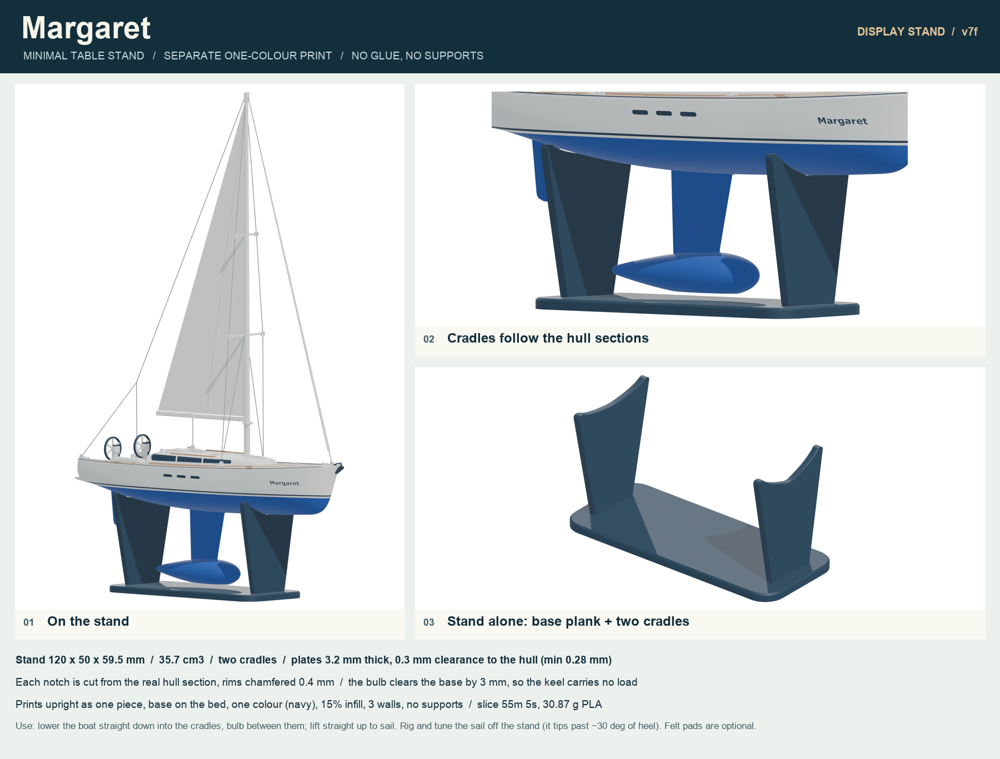

# Margaret — 200 mm free-sailing yacht (v7f)

A printable model in the style of a **Jeanneau Sun Odyssey 43**: a likeness, not a copy. She has a blue underwater hull, white topsides and deck, a navy boot stripe and trim, and caulked teak on the cockpit, side decks and foredeck. **Margaret** is on both bows and repeated on the port transom face, and a navy delta anchor sits stowed on the bow roller.

The model prints as **one Bambu P2S plate in four colours**. It has a detachable, fillable ballast bulb, a keyed mast stayed with thread, and three interchangeable paper mainsails. A separate minimalist table stand prints in one colour.

| File | Use |
| --- | --- |
| `Margaret-P2S.3mf` | Bambu Studio **project, already sliced**: one plate, 9 parts, 16 colour volumes. |
| `Margaret-paper-sails.pdf` | 1:1 templates: **start / medium / full** mainsails, an optional furled-genoa strip, rigging and trim notes. |
| `Margaret-afloat.png` | The exported model floated at its calculated waterline, upright and at 15° heel. |
| `Margaret-sail-rigging.png` | Where the paper sail is tied: head, luff, tack, clew and mainsheet. |
| `Margaret-stand.png` | The display stand: boat on the stand, the cradles and the stand alone, with print settings. |
| `Margaret-stand.3mf` | Bambu Studio project for the stand, **already sliced**: one navy part, no supports. |
| `Margaret.blend` | Editable assembled model (1 unit = 1 mm). Collections for each print group and for the thread/paper preview, plus seven cameras. The display stand is in its own collection. |
| `views/` | Six renders: bow quarter, both profiles, cockpit, deck plan, exploded bulb with lead. `views/details/` has close-ups of the anchor, bow, foredeck and stern name, plus `name-depth-coupons.png` (why the name is 0.8 mm deep) and `name-gcode-check.png` (both names as the printer will lay them down). `views/afloat/` shows her at the calculated waterline, and `views/stand/` the stand renders. |
| `stl/` | Every printable colour body, in **assembled position** (not print orientation). `Stand.stl` is the stand in the same coordinates, so it lines up with the boat. |
| `data/` | `stats.json` (dimensions, rig, sails), `stability.json` (sails, heel, CLR/CE), `hydro_check.json` (float, trim, righting curve), `mass.json` (sliced on-board mass per part), `checks.json` (clearances), `float.json`, `stand.json` (stand size and hull clearance), `namecheck.json` and `transom_gates.json` (G-code proof that both names print legibly). |
| `scripts/` | Reproducible pipeline. `build_v7.py` builds the model (Blender 5.2, `MARGARET_OUT=<dir>`). The other scripts check, plate, slice-prep, compute hydrostatics, render and make the sheets/PDF. `scripts/coupon/` holds the name-printing experiment and the G-code name gates. |
| `REVIEW.md` | Full multi-model challenge/defend log (Steps 0–7f) with each accept/defend decision. |

## Dimensions and proportions

| | Margaret | Real SO43 at 1:66 | Notes |
| --- | ---: | ---: | --- |
| Length overall | **200.0 mm** | 200 mm | 13.21 m ÷ 66.05 |
| Hull length | 197.5 mm | 194.4 mm | Plumb bow, raked open transom |
| Beam | 63.4 mm | 63.4 mm | |
| Waterline length | ≈ 180 mm | 173 mm | Slightly fuller ends for buoyancy |
| Freeboard (midships) | ≈ 15.6 mm | | |
| Draft | 55.5 mm | 30.3 mm | **Deliberately 1.8× deeper** so a model this small stands up to a breeze |
| Masthead above waterline | 240 mm | ≈ 257 mm | One-piece mast, limited by the 256 mm bed |
| Mast position | ≈ 37 % of LOA from the bow | similar | |
| Mainsail (paper) | 26 / 32 / 66 cm² | | Start / medium / full |

The above-water shape (sheer, coachroof, deck plan, open stern) follows the SO43 proportions. The keel and rig are changed on purpose: a scale keel and full-height rig would capsize a 64 g model in the lightest breeze.

## Will she float? (calculated from the exported STLs and the sliced masses)

| Item | Value |
| --- | ---: |
| Printed parts on board (per-object G-code mass) | 45.9 g |
| Paper sail, thread, seam glue, bulb glue | 2.1 g |
| Lead: **100 × 3 mm balls** | 16.0 g |
| **All-up mass** | **64.0 g** |
| Displacement at the design waterline (boot stripe) | 63.9 g |
| Hull sits deeper than designed / trim, lead poured **level** | 0.03 mm / 0.1° bow-down (bow 0.2 mm) |
| Metacentric height GM | 19 mm |
| Righting arm at 10° / 20° / 30° | 3.3 / 6.1 / 8.4 mm |
| Sealed hull self-rights up to (water in the cockpit past 130° is not modelled) | 141° |
| Deck edge reaches the water at | 31° |
| Water reaches the cockpit at | 130° |
| Extra lift if pushed fully under (sealed hull) | 165 g |
| Bulb capacity | ≈ 129 balls simulated ball-by-ball (100 needed) |

The bulb is placed so that lead poured in level trims her flat (v7 was 0.7° bow-down; the bulb moved 12 mm aft). The fin joins the front third of the bulb, as on real bulb keels.

**These are predictions, not test results.** The physical check is simple: weigh the dry, rigged boat, then add lead until boat + lead = **64 g**. She should float with the water just under the blue/white line.

## Printing

- **Settings:** Bambu Lab P2S, 0.4 mm nozzle, Bambu PLA Basic, **Textured PEI plate**. 0.16 mm layers, 2 walls, 7 % infill, supports from the build plate only, prime tower.
- **AMS mapping:** 1 white `#F6F5EE`, 2 blue `#15499D`, 3 navy `#173347`, 4 teak/tan `#BF8A54`.
- **Sliced result:** 13 h 03 min model time, 13 h 10 min total (235 layers), 207.8 g filament in total: white 80.1, blue 43.4, navy 55.4 (mostly purge), teak 29.0 g. About 320 colour changes; nothing outside the bed.
- **Mass that ends up in the boat:** **45.9 g** (summed from the G-code per object, excluding supports and purge).
- **Orientation, as laid out on the plate:**
  - Both hull halves print seam-face down. Supports inside them come out through the open seam.
  - The ballast cup prints opening up.
  - The fin with its bulb cap prints split face down.
  - The mast prints flat on its aft face. The boom, rudder and wheels print flat.
- Don't scale or re-orient parts. The joints are sized for this slice.

## Assembly

1. **Clean up.** Remove the supports inside both hull halves. Clear the holes with a fine pin: the mast and boom holes, the padeyes, the 4 hull lug holes and the 2 bulb post holes.
2. **Hull.**
   - The lower blue hull and the white upper hull join at a seam **2.5 mm above the waterline**.
   - Push 6.5 mm lengths of 2 mm rod into the 4 lug holes; 1.75 mm filament plus glue also works.
   - Dry-fit, then bond the whole seam with slow epoxy. This seam must be **watertight**.
   - Float the empty hull for 10 minutes and check for seepage.
3. **Fin.** Glue the fin tenon into the socket under the hull (0.2 mm clearance per side). The fin is part of the top half of the bulb, so there is no gap between keel and bulb.
4. **Rudder.** The Ø2 mm stock pushes up into its Ø2.1 bore. Friction holds the trim, and the slotted navy cap on deck lets you turn it.
5. **Wheels.** Push each wheel's stub axle into the teardrop bore on its binnacle and fix it with a drop of CA. The rim faces aft, toward the helm seat.
6. **Mast and boom.**
   - The D-shaped heel keys into the blind deck socket; no glue is needed.
   - Tie a thread loop through the boom's forward hole and round the mast, so the boom sits on the gooseneck saddle at 43 mm and swings freely (checked clear through ±45°).

## Stern and decks

- **Open stern:** the cockpit sole steps down to a full-width teak bathing platform, set into a reverse-raked transom (~8°). The folding swim ladder lies stowed fore-aft on the platform, in navy relief.
- **Teak:** cockpit sole and seats, side decks and foredeck. Planks spring parallel to the deck edge and are **nibbed** square into the king plank and coachroof margins at the bow, as on real teak decks.

## Bow anchor and transom name

- **Anchor:** a delta-style anchor lies stowed on the bow roller, shank along the fitting and fluke tucked under the stem, as on the real boat. It is printed as part of the white upper hull and coloured navy, so there is nothing to glue. It stays inside the 200 mm length and adds no supports.
- **Name on the stern:** **Margaret** is inlaid 0.8 mm into the port transom face, beside the walk-through to the bathing platform, and reads left to right from astern. It matches the bow names (navy, bold).
- A small white pad inside the transom keeps 0.85 mm of white behind the letters. Shallower inlays (0.4 and 0.6 mm) looked fine in Blender but sliced into broken navy fragments; test coupons showed 0.8 mm is the depth at which the slicer prints every stroke. The real plate's G-code was checked letter by letter: every stroke of every letter prints on every layer (`data/transom_gates.json`).

## Thread rig (holds the mast up)

Use 0.2–0.25 mm dark polyester thread. Tension each stay only until it is **just taut**, then sight up the mast from the bow and keep it straight.

- **Forestay and backstay:**
  - One thread runs from the bow padeye, through the masthead hole (fore–aft), and down aft.
  - At about 80 % of the way down, knot it into a V bridle. The two legs go to the two stern padeyes.
- **Cap shrouds:**
  - One thread passes through the hounds hole. Each end runs down through the **upper and then the lower spreader-tip holes** to the side padeye (±18.5 mm, beside the mast).
  - The spreaders push each shroud out by 2.7–3.2 mm, so they brace the mast.
- **Lower shrouds:** tie round the mast just under the lower spreader and run to the same side padeyes.
- **Furled genoa (optional, cosmetic):** roll the paper strip from the PDF round the forestay. It is not a working sail.

**The masthead is held by these stays, never by the paper.**

## Paper sails

Print the PDF at **100 %** and check the 50 mm bar. Use 80–100 g/m² paper. Laminate both faces with clear tape (this also waterproofs it), then pierce the marked holes. The sail weighs ≈ 0.5 g and is already in the 64 g budget.

1. **Head:** tie the reinforced head hole to the masthead hole (full sail), or round the mast just above the upper spreader (start and medium).
2. **Luff:** a small thread loop through each luff hole and round the mast, every 20 mm. Keep them off the spreader roots (dashed marks).
3. **Tack:** lash the tack hole round the mast just above the boom.
4. **Clew:** tie it down to the matching boom hole. Counting from the aft end of the boom: full 1st (70 mm aft of the mast), medium 2nd (58 mm), start 3rd (46 mm).
5. **Mainsheet:** from the 4th boom hole down to the eye on the coachroof below it. Tie it so the boom sits about 15° off the centreline to start.

| Sail | Area | Heel at 1 m/s | Heel at 1.5 m/s | Heel at 2 m/s | Use |
| --- | ---: | ---: | ---: | ---: | --- |
| **Start** | 26 cm² | 1° | 2° | 4° | First trials, normal light breeze |
| Medium | 32 cm² | 1° | 3° | 5° | Steady light air |
| Full | 66 cm² | 3° | 7° | 12° | **Only below ≈ 1.5 m/s**, or display |

The sail's centre of effort is slightly ahead of the keel's centre of lateral resistance (4 mm with the full sail, 12 mm with the start sail), so she may bear away. Turn the rudder's trailing edge a few degrees to windward and ease the sheet until she sails straight.

## Ballast (detachable bulb, 3 mm lead balls)

The bulb splits at a horizontal glue plane. The **upper half (fin cap)** is part of the fin. The **lower half (cup)** is a hollow shell with 0.9 mm walls. Two Ø2 mm posts in the cup locate it in Ø2.4 mm holes in the cap. They stop it rotating, but they do not hold it on.

1. **Weigh** the finished, rigged boat without lead. Lead target = **64 g − that mass** (≈ 16 g ≈ 100 balls at 0.16 g each).
2. **Pour the lead in level** (the cup standing upright) and press the cup onto the cap. **Tape the seam all round with waterproof tape** for trials; the bulb stays fully detachable.
3. **Float it in a tank.** The water should sit just under the blue/white line, level fore and aft. Check that she rights herself from a gentle heel to both sides.
4. **Sail on a retrieval line**, start sail first.
5. **Close the bulb for good.**
   - Lock the balls with a little thin epoxy (counted in the 0.4 g bulb-glue allowance).
   - Glue the cup to the cap with epoxy on the full rim.
   - Repeat the float test.

**Lead safety:** use intact balls; never cut, sand or heat lead. Keep it away from children and pets, wash your hands after handling, and seal it fully in epoxy.

## Display stand (separate print)

A minimalist navy stand: a 120 × 50 mm base plank and two upright cradles. Each cradle notch is cut from the actual hull section where it sits, with 0.3 mm clearance, so the hull rests on its own shape. The bulb hangs 3 mm clear of the base, so the keel joint carries no load.

- **Print:** open `Margaret-stand.3mf` and print as sliced. One piece, upright, navy PLA, 15 % infill, 3 walls, no supports. 55 min, 31 g.
- The notch rims are chamfered 0.4 mm so the hull slides in without catching on a sharp edge.
- **Use:** lower the boat straight down into the cradles with the bulb between them. Lift straight up to take her sailing. Optional felt pads under the base protect the table.
- **Rig and tune the sail off the stand.** On the stand she tips over at about 31° of heel, so don't tension stays or tie the sail while she sits in it.
- The stand does not touch the rudder, the bulb or the stays.

## Rebuilding (optional)

All scripts are in `scripts/` and expect Blender 5.2 and Bambu Studio on macOS. Run them in this order:

1. `MARGARET_OUT=build blender -b --factory-startup -P build_v7.py` (generator; needs `hullgen.py` and `hull_params_v7.json` beside it).
2. `MARGARET_OUT=build blender -b --factory-startup -P check_v7.py`, then `plate_v7.py` the same way.
3. In `build/plate`: `MARGARET_WORK=$PWD python3 prepare_slice.py`, slice with Bambu Studio's CLI, then `gcode_mass.py` on the G-code to get `mass.json`.
4. `SLICE_MASS=build/plate/mass.json MARGARET_OUT=build python3 hydro_check.py` (float, trim, righting curve), and `stability_v7.py` in Blender with the same variables (sails, heel, CE/CLR).
5. `present_v7.py`, `float_v7.py`, `closeups.py` (renders), then `presentation_v7.py` (sheets and PDF).
6. Stand: `MARGARET_OUT=build STAND_OUT=build/stand blender -b --factory-startup -P stand_v7.py`, then `./stand_slice.sh <abs path to build/stand>` and `stand_show.py` (adds it to the blend and renders it).

7. Name gates on the sliced plate: `python3 coupon/transom_gates.py build` (must print PASS) and `python3 coupon/namecheck.py build preview.png`.

`run_chain.sh <tag>` runs steps 2–5 in one go (paths at the top of the script point to the author's machine).

## Status

The design has been modelled and checked digitally:
- all parts are manifold, with no tiny colour islands
- clearance and swing checks pass, with **0 mm³** overlap between the cup and the cap
- the plate has been sliced, and the per-part G-code mass was fed back into the float calculation
- the G-code was checked layer by layer to prove both names print legibly
- buoyancy, trim and the righting curve were computed independently from the exported STLs
- all of the above was challenged by several independent model reviewers (see `REVIEW.md`).

A correction from v6: the v6 heel calculation had an error that **understated** stability. v7 recomputed it independently; the boat is stiffer than v6 reported.

**It has not yet been printed, leak-tested or sailed.** The ball count, trim and heel figures are calculations. Confirm them in the tank before gluing the bulb shut.
