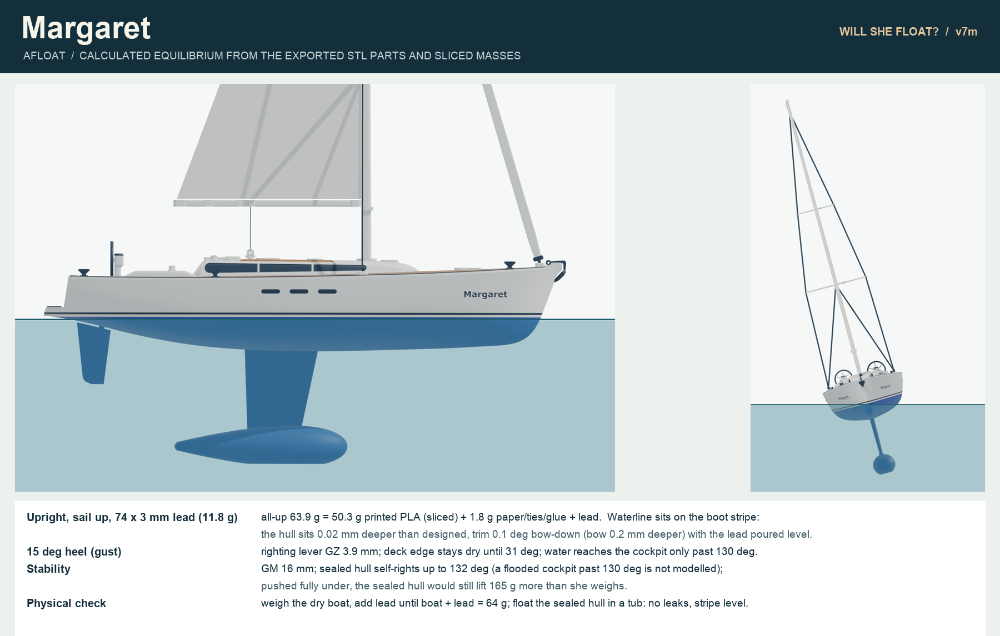
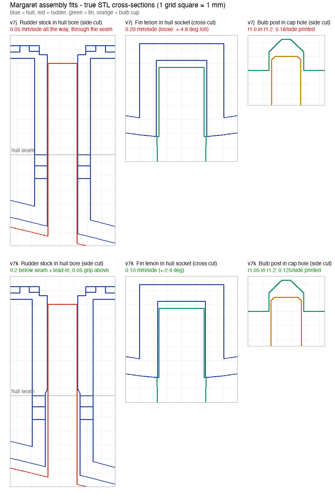
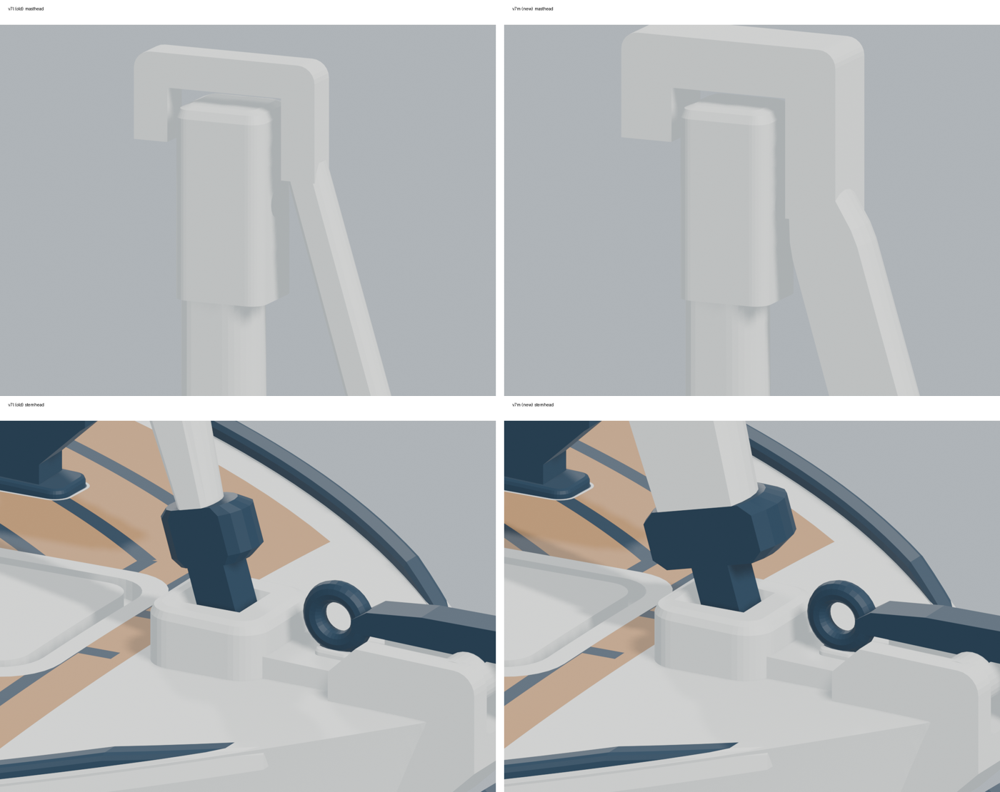

# Margaret — 200 mm free-sailing yacht (v7m)

A printable model in the style of a **Jeanneau Sun Odyssey 43**: a likeness, not a copy. She has a blue underwater hull, white topsides and deck, a navy boot stripe and trim, and caulked teak on the cockpit, side decks and foredeck. **Margaret** is on both bows and repeated on the port transom face, and a navy delta anchor sits stowed on the bow roller as a separate-looking fitting. Six **navy horn cleats** are printed into the deck. There are no railings: at 1:66 a stanchion would be 0.4 mm and a lifeline 0.1 mm, finer than a 0.4 mm nozzle can print.

The model prints as **one Bambu P2S plate in four colours**. It has:
- a detachable, fillable ballast bulb;
- a keyed mast with a **printed navy shroud frame** whose chainplates sit **near the deck edge**, as on the real boat (no thread stays);
- a printed furled genoa for display;
- three interchangeable paper mainsails carrying the sail number **MGT 43**.

A separate swan-neck table stand prints in one colour. It **rises from aft, between the rudder and the keel**, and lifts her up by the hull without any pins. An optional printed display mainsail carries the same markings.

| File | Use |
| --- | --- |
| `Margaret-P2S.3mf` | Bambu Studio **project, already sliced**: one plate, 10 parts, 19 colour volumes. |
| `Margaret-paper-sails.pdf` | 1:1 templates: **start / medium / full** mainsails with the MGT 43 markings, an optional furled-genoa strip, rigging and trim notes. |
| `Margaret-afloat.png` | The exported model floated at its calculated waterline, upright and at 15° heel. |
| `Margaret-sail-rigging.png` | Where the paper sail is tied: head, luff, tack, clew and mainsheet. |
| `Margaret-stand.png` | The swan-neck stand rising from aft: boat on the stand with the printed display sail, the fork under the hull, the stand alone and the port profile, with print settings. |
| `Margaret-stand.3mf` | Bambu Studio project for the stand, **already sliced**: one navy part, tree supports under the fork head only. |
| `Margaret-display-sail.3mf` | Optional printed display mainsail, **already sliced**: white with navy markings, laid flat, three peel-off mouse ears. Display only. |
| `Margaret.blend` | Editable assembled model (1 unit = 1 mm). Collections for each print group and for the paper-sail preview, plus seven cameras. The display stand and the printed display sail each have their own collection (the display sail is hidden in renders by default). |
| `views/` | Six renders: bow quarter, both profiles, cockpit, deck plan, exploded bulb with lead. `views/details/` has close-ups of the anchor, bow, foredeck, stern name, deck edge (`deck-edge`), cleats (`cleat-*`), chainplate and rig, plus `name-depth-coupons.png` (why the name is 0.8 mm deep) and `name-gcode-check.png` (both names as the printer will lay them down). `views/afloat/` shows her at the calculated waterline, and `views/stand/` the stand renders plus both faces of the printed display sail with its markings. |
| `stl/` | Every printable colour body, in **assembled position** (not print orientation), including `Shrouds`, `Furler`/`Furler_ink`, `Stand` and `Display_sail`/`Display_sail_ink`, all in the same coordinates as the boat. |
| `data/` | `stats.json` (dimensions, rig, furler, anchor, sails), `stability.json` (sails, heel, CLR/CE), `hydro_check.json` (float, trim, righting curve), `mass.json` (sliced mass per part), `checks.json` (clearances and fits), `float.json`, `stand.json` (stand size, clearances, lift-off path, forward hold, tipping angles), `stand_strength.json` (neck stress on every print layer, safety factors, sag), `display_sail.json` (size, mass, markings), `namecheck.json` and `transom_gates.json` (G-code proof that both names print legibly). |
| `scripts/` | Reproducible pipeline. `build_v7.py` builds the model (Blender 5.2, `MARGARET_OUT=<dir>`). The other scripts check, plate, slice-prep, compute hydrostatics, render and make the sheets/PDF; `stand_neck.py`, `stand_strength.py`, `display_sail.py` and `sail_marks.py` make and check the stand, the display sail and the shared sail markings. `scripts/coupon/` holds the name-printing experiment and the G-code name gates. |
| `REVIEW.md` | Full multi-model challenge/defend log (Steps 0–13) with each accept/defend decision. |

## Dimensions and proportions

| | Margaret | Real SO43 at 1:66 | Notes |
| --- | ---: | ---: | --- |
| Length overall | **200.0 mm** | 200 mm | 13.21 m ÷ 66.05 |
| Hull length | 197.5 mm | 194.4 mm | Plumb bow, raked open transom |
| Beam | 63.4 mm | 63.4 mm | |
| Waterline length | ≈ 180 mm | 173 mm | Slightly fuller ends for buoyancy |
| Freeboard (midships) | ≈ 15.6 mm | | |
| Draft | 55.5 mm | 30.3 mm | **Deliberately 1.8× deeper** so a model this small stands up to a breeze |
| Masthead above waterline | 240 mm | ≈ 257 mm | One-piece mast, limited by the 256 mm bed |
| Mast position | ≈ 37 % of LOA from the bow | similar | |
| Mainsail (paper) | 26 / 32 / 66 cm² | | Start / medium / full |

The above-water shape (sheer, coachroof, deck plan, open stern) follows the SO43 proportions. The keel and rig are changed on purpose: a scale keel and full-height rig would capsize a 64 g model in the lightest breeze.

## Will she float? (calculated from the exported STLs and the sliced masses)

| Item | Value |
| --- | ---: |
| Printed parts on board (per-object G-code mass; the display furler stays ashore) | 50.3 g |
| Paper sail, ties, seam glue, bulb glue | 1.8 g |
| Lead: **74 × 3 mm balls** | 11.8 g |
| **All-up mass** | **63.9 g** |
| Displacement at the design waterline (boot stripe) | 63.9 g |
| Hull sits deeper than designed / trim, lead poured **level** | 0.02 mm / 0.1° bow-down (bow 0.2 mm) |
| Metacentric height GM | 15.9 mm |
| Righting arm at 10° / 20° / 30° | 2.7 / 5.0 / 6.8 mm |
| Sealed hull self-rights up to (water in the cockpit past 130° is not modelled) | 132° |
| Deck edge reaches the water at | 31° |
| Water reaches the cockpit at | 130° |
| Extra lift if pushed fully under (sealed hull) | 165 g |
| Bulb capacity | ≈ 127 balls simulated ball-by-ball (74 needed) |

The bulb is placed so that lead poured in level trims her flat. The fin joins the front third of the bulb, as on real bulb keels. v7j thickens the underwater hull from 0.85 to 1.2 mm (a test print of the blue half came out too thin). That adds 3.7 g of PLA, which replaces 23 balls of lead to keep the 64 g all-up mass; her centre of gravity rises 2.6 mm, so GM drops from 18.6 to 16.0 mm and the righting arm at 30° from 8.1 to 6.8 mm. She is still stiff for a light-air model: the full sail heels her 14° at 2 m/s instead of 12°. v7k only changes the joint clearances (see Assembly); it moves 0.07 g of PLA and one lead ball, and GM is 15.9 mm. v7l only opens the rudder bore to Ø2.5 (the printed Ø2.1 bore did not take the stock); mass, lead and float figures are unchanged. v7m only thickens the display furler, which stays ashore, so nothing here changes.

**These are predictions, not test results.** The physical check is simple: weigh the dry, rigged boat (without the furler), then add lead until boat + lead = **63.9 g**. She should float with the water just under the blue/white line.

## Printing

- **Settings:** Bambu Lab P2S, 0.4 mm nozzle, Bambu PLA Basic, **Textured PEI plate**. 0.16 mm layers, 2 walls, 7 % infill, supports from the build plate only, prime tower.
- **Hull walls (v7j):** 1.2 mm below the waterline, rising smoothly to the 1.7 mm seam land; 0.85 mm topsides. The thickness is in the model, so no slicer change is needed: the G-code lays two wall lines with solid infill between them, and per layer it deposits 90–97 % of the cross-section area, so there are no gaps (`scripts/wall_fill.py`).
- **AMS mapping:** 1 white `#F6F5EE`, 2 blue `#15499D`, 3 navy `#173347`, 4 teak/tan `#BF8A54`.
- **Sliced result (v7m):** 13 h 17 min model time, 13 h 24 min total (235 layers), 214.4 g filament in total: white 81.7, blue 46.3, navy 57.5 (mostly purge), teak 28.9 g. About 320 colour changes; nothing outside the bed.
- **Mass of the printed parts:** **51.8 g** summed from the G-code per object (excluding supports and purge): 50.3 g goes sailing, plus the 1.5 g display furler. The lower hull alone is 16.0 g (12.2 g in v7i).
- **Orientation, as laid out on the plate:**
  - Both hull halves print seam-face down. Supports inside them come out through the open seam.
  - The ballast cup prints opening up.
  - The fin with its bulb cap prints split face down.
  - The mast and its navy shroud frame print as one part, flat on the mast's aft face.
  - The furler prints flat on its flat face: 2.8 mm tall, 17 layers with a solid core, 1.9–2.7 mm on the bed along its whole length. When the plate has cooled, flex the plate and lift the furler from the drum end, not by the hook. The boom, rudder and wheels print flat.
- Don't scale or re-orient parts. The joints are sized for this slice.
- **Upgrading a v7l print to v7m:** reprint only the **furler**. In v7l it was too thin to print well (11 layers, walls only, about 1 mm on the bed). Nothing else changed: the hull and all other parts are geometrically identical, and the new furler fits the existing stemhead pocket and masthead cap. In Bambu Studio, open `Margaret-P2S.3mf`, delete every object except the furler, and slice.
- **Upgrading a v7j (or earlier) print to v7l:** reprint only the **lower hull** (1.2 mm bottom, tighter fin socket, Ø2.5 rudder bore). Reprinting the **ballast cup** is optional; it gives tighter posts. Keep the upper hull, fin, rudder and everything else: the upper hull's old Ø2.1 rudder bore is opened by the Ø2.4 drill pass in Assembly step 2. In Bambu Studio, open `Margaret-P2S.3mf`, delete the other objects from the plate, and slice.

## Assembly

Joint clearances in v7l, measured on the sliced toolpaths (`data/fits_gcode_v7l.json`) and reviewed in `REVIEW.md` Steps 14–15. Small printed holes come out smaller than these toolpath figures (the v7j rudder failed this way), so the rudder now has real running clearance:

| Joint | Model | As printed (per side) | Purpose |
| --- | --- | --- | --- |
| Fin tenon in hull socket | 0.10 mm | 0.10 / 0.11 mm | epoxied; small enough to square by hand |
| Rudder stock in its bore (both halves) | 0.25 mm (Ø2.5 bore, Ø2.0 stock) | 0.18–0.24 mm on the toolpaths; ≈ 0.1–0.2 mm after the Ø2.4 drill pass | free running; PTFE tape on the stock holds trim |
| Bulb posts in cap holes | 0.15 mm | ≈ 0.12 mm | locate the cup; tape or epoxy holds it |
| Wheel stubs in binnacle bores | 0.2 mm | 0.2 mm, 0.8 mm spare depth | CA glued |

1. **Clean up.** Remove the supports inside both hull halves. Clear the holes with a fine pin: the mast and boom holes, the sheet eye, the 4 hull lug holes and the 2 bulb post holes. Check that the two chainplate pockets and the stemhead pocket are clear.
2. **Hull.**
   - The lower blue hull and the white upper hull join at a seam **2.5 mm above the waterline**.
   - Push 6.5 mm lengths of 2 mm rod into the 4 lug holes (Ø2.15 mm, 3.5 mm deep in each half). 1.75 mm filament also works, but it has about 0.2 mm of play per side and will not line up the boot stripe by itself: align it by eye and tape or clamp the halves while the epoxy cures. The pins only line the halves up.
   - Sand off any elephant foot on both seam faces so the halves close flush at the boot stripe.
   - **Use the 2 mm rod pins**, not filament, for the glue-up: the rudder bore runs through both halves, and filament pins allow a 0.2 mm step at the seam that eats the rudder's clearance.
   - Dry-fit all four pins, then bond the whole seam with slow epoxy. The epoxy on the 1.7 mm-wide seam land is what holds the halves together and seals them. This seam must be **watertight**.
   - Glue the ring of seam land round the rudder tube too: it is the seal between the flooded rudder tube and the inside of the hull.
   - **After the epoxy cures, true the rudder bore:** twist a **Ø2.4 mm drill bit by hand** (pin vise or fingers, no power drill) down through the bore from the deck in one pass. It clears any seam step, squeeze-out and blobs. On halves printed before v7l (Ø2.1 bore) the same pass opens the bore and leaves a 0.73 mm wall; do not use Ø2.5 on those.
   - The v7l lower half mates with an already-printed v7i or v7j upper half. The outside, the seam outline and the lugs are unchanged (checked to 0.01 mm), so **no upper-hull reprint is needed**; the drill pass above opens its rudder bore.
   - Float the empty hull for 10 minutes and check for seepage, including round the rudder tube.
3. **Fin.** The socket is **0.1 mm per side** larger than the tenon (v7j had 0.2 mm, which let the fin rock ±4.8°; now about ±2.4° before glue). Dry-fit first. Then turn the hull upside down on its seam face, fill the socket with slow epoxy, push the tenon in, square the fin to the hull with a set square, and tape it until cured; the epoxy fills the gap and fixes the angle. The fin is part of the top half of the bulb, so there is no gap between keel and bulb.
4. **Rudder.** First push the bare rudder up from below: the Ø2 mm stock must turn freely in its bore. If it binds, scrape the thin ridge along the side of the stock that printed on the bed. Then wind **1–2 turns of PTFE plumber's tape** round the stock in a 2 mm band starting 0.5 mm below its top (the slotted tip sits in the deck counterbore and touches nothing). Push it back in and add or remove a turn until it turns with firm finger pressure, holds its angle and does not drop out. The slotted navy tip on deck lets you set the trim. Don't use paper masking tape: it goes soft in the wet tube and seizes.
5. **Wheels.** Push each wheel's Ø1.6 mm stub axle into the teardrop bore (Ø2.0, 0.2 mm per side) on its binnacle and fix it with a drop of CA. The bore is about 0.8 mm deeper than the stub. The rim faces aft, toward the helm seat.
6. **Mast and shroud frame.**
   - Lower the mast straight down: the D-shaped heel keys into the blind deck socket while the two shroud-frame foot tabs drop into the chainplate pockets near the deck edge (0.2 mm clearance per side).
   - The heel bottoms in its socket and carries the weight; the tabs stop 0.5 mm above the pocket floors and only brace the mast sideways. No glue is needed, so the mast lifts out for transport. A drop of CA in each pocket makes it permanent.
7. **Boom.** Tie a thread loop through the boom's forward hole and round the mast, so the boom sits on the gooseneck saddle at 43 mm and swings freely (checked clear through ±45°).
8. **Furled genoa (display only).** Drop the navy foot tab into the stemhead pocket on the bow, then hang the hook over the masthead cap (0.39 mm clearance). Lift it off before sailing. The white body butts onto the navy drum; if they ever part, a drop of CA glue rejoins them.
9. **Cleats** are printed into the deck, so there is nothing to fit.

## Stern and decks

- **Open stern:** the cockpit sole steps down to a full-width teak bathing platform, set into a reverse-raked transom (~8°). The folding swim ladder lies stowed fore-aft on the platform, in navy relief.
- **Teak:** cockpit sole and seats, side decks and foredeck. Planks spring parallel to the deck edge and are **nibbed** square into the king plank and coachroof margins at the bow, as on real teak decks.

## Cleats, and why there are no railings

- **No railings.** v7h had printed navy railings (pulpit, stanchions, lifelines and pushpit): fences 0.68 mm thick with 1.0 mm posts, glued into 20 deck pockets. They were removed in v7i, on the owner's call and with all three reviewers agreeing. At 1:66 a real stanchion is 0.38 mm and a lifeline 0.09 mm, so the thinnest posts a 0.4 mm nozzle prints read as a fence, not as wire. The navy toe rail along the deck edge, the cleats and the chainplates now carry the edge detail, and the teak runs unbroken where the pads were.
- **Cleats:** six navy horn cleats are printed into the deck: a pair at the bow, a pair midships, and a pair on the stern quarters. Each is 4.2 × 1.2 mm and 2.72 mm tall. A short straight waist leaves daylight under each horn, and every overhang is 45° or less, so no supports are needed. The earlier cleats were white on white cut-outs in the teak, which made them invisible.

## Bow anchor and transom name

- **Anchor:** a navy delta anchor lies stowed on the bow roller, and reads as a separate fitting although it prints as part of the white upper hull (nothing to glue):
  - its 1.0 mm shank runs over the roller between the cheeks with 0.65 mm of daylight each side and 0.9 mm of air under it;
  - it rests only on the roller and, through a D-ring shackle, on a small white deck chock;
  - the fluke hangs ahead of the stem with a 0.75 mm shadow gap and touches it only at its toe, which is where its print starts. The crown stands about 1.5 mm proud of the cheeks.
  - It stays inside the 200 mm length and adds no supports.
- **Name on the stern:** **Margaret** is inlaid 0.8 mm into the port transom face, beside the walk-through to the bathing platform, and reads left to right from astern. It matches the bow names (navy, bold).
- A small white pad inside the transom keeps 0.85 mm of white behind the letters. Shallower inlays (0.4 and 0.6 mm) looked fine in Blender but sliced into broken navy fragments; test coupons showed 0.8 mm is the depth at which the slicer prints every stroke. The real plate's G-code was checked letter by letter: every stroke of every letter prints on every layer (`data/transom_gates.json`).

## Rig and sails: display or sailing

**In short:** the whole rig is printed and needs no thread stays. The mast stands in its keyed blind socket. A flat navy **shroud frame**, printed in one piece with the mast, carries the cap shrouds from the hounds over both spreader tips, and the lower shrouds, down to chainplates **near the deck edge** (±26.0 mm, 86 % of the half-beam, just inboard of the toe rail), as on the real boat. The spreaders are widened to match: 24.0 mm half-span lower, 14.5 mm upper. There is no backstay: a printed split backstay does not fit on the plate, and the masthead is too thin for a clip, so the rig carries only what can be printed. The forestay is suggested by the printed **furled genoa**. The paper sail weighs about 0.5 g, so she floats on her line and sails; the printed display sail weighs 4.5 g, so it is for the shelf.

| Purpose | Rig | Sail |
| --- | --- | --- |
| **Sailing** | Printed mast + shroud frame, boom; furler **off** | Paper (start / medium / full), 0.5–0.7 g |
| **Display** | The same, plus the printed furled genoa | Paper full sail, or the **printed display sail** (`Margaret-display-sail.3mf`) |

- **Scale honesty:** the shroud strips are 1.0 × 0.6 mm, about 66 mm thick at full size, which is what a 0.4 mm nozzle prints reliably. They read as rigging in navy, and they brace the mast sideways without any tensioning.
- **Furler:** a 226 mm white furled genoa on a navy drum (3.8 × 2.8 mm). Its D-shaped section is 2.6 mm wide at the drum, 3.4 mm at the belly and tapers to 2.3 mm at the head; it prints 2.0–2.4 mm tall. The hook is 1.5 × 2.0 mm. Its foot tab sits in the stemhead pocket (0.2 mm clearance) and the hook hangs over the masthead cap.

**Sail markings (paper and printed):**
- The sail number is **MGT 43** (code over number), in 6.8 mm capitals: the racing-rules minimum of 450 mm for a boat over 11 m, at 1:66. Two navy waves near the head are Margaret's insignia. Two reef rows show cringle patches and reef points.
- As on a real mainsail, each side carries its own set: the **port** set is lower and reads normally from port; the **starboard** set is higher and reads correctly from starboard. On the paper template the starboard set is printed mirrored, so it reads through the taped sheet.
- The marked paper main is shown in `Margaret-views.png`. To use another code or number, set `SAIL_CODE` / `SAIL_NO` before running `display_sail.py` and `presentation_v7.py`.

**Printed display sail (optional):**
- The same outline and holes as the FULL paper sail: 0.52 mm white PLA with seven cross-cut seams, four battens, raised tabling and corner patches on the starboard face.
- **Markings in navy:** the port number is inlaid into the first layer (crisp on the bed face); the starboard number is a 0.16 mm relief on a seam-free panel (seams stop 0.6 mm short of the numbers); the wave insignia goes through the full thickness.
- 66.9 cm², 4.5 g. About 20 min to print (27 min with heating and calibration); 6.8 g white and 0.8 g navy filament including purge.
- Print flat as sliced, no supports. Let the plate cool before peeling it off, then peel or snip off the three Ø10 mm mouse ears at the head, tack and clew (they only stop the corners lifting).
- Tie it on exactly like the paper full sail (same holes, same thread).
- **Don't sail with it.** It is about 8× the paper sail's weight, high up: it raises her centre of gravity by about 7 mm and cuts the metacentric height from 16.0 to about 9 mm. She still floats upright, but heels much more. Swap to paper before she goes in the water.
- If the starboard number prints faint on your printer, rebuild with a 0.24 mm relief (`display_sail.py`, one more layer).

## Paper sails

Print the PDF at **100 %** and check the 50 mm bar. Use 80–100 g/m² paper. The grey lines inside each outline are cloth detail (seams, battens, tabling, corner patches, reef rows); the navy marks are the sail number and insignia. Cut on the black line; the labels stay on the waste paper below the foot. Laminate both faces with **matte** clear tape (it waterproofs the sail and keeps the grey seams visible without shine), then pierce the marked holes. The full sail weighs ≈ 0.5–0.7 g with tape and is already in the 64 g budget.

1. **Head:** tie the reinforced head hole to the masthead hole (full sail), or round the mast just above the upper spreader (start and medium).
2. **Luff:** a small thread loop through each luff hole and round the mast, every 20 mm. Keep them off the spreader roots (dashed marks).
3. **Tack:** lash the tack hole round the mast just above the boom.
4. **Clew:** tie it down to the matching boom hole. Counting from the aft end of the boom: full 1st (70 mm aft of the mast), medium 2nd (58 mm), start 3rd (46 mm).
5. **Mainsheet:** from the 4th boom hole down to the eye on the coachroof below it. Tie it so the boom sits about 15° off the centreline to start.

| Sail | Area | Heel at 1 m/s | Heel at 1.5 m/s | Heel at 2 m/s | Use |
| --- | ---: | ---: | ---: | ---: | --- |
| **Start** | 26 cm² | 1° | 3° | 4° | First trials, normal light breeze |
| Medium | 32 cm² | 1° | 3° | 6° | Steady light air |
| Full | 66 cm² | 4° | 8° | 14° | **Only below ≈ 1.5 m/s**, or display |

The sail's centre of effort is slightly ahead of the keel's centre of lateral resistance (4 mm with the full sail, 12 mm with the start sail), so she may bear away. Turn the rudder's trailing edge a few degrees to windward and ease the sheet until she sails straight.

## Ballast (detachable bulb, 3 mm lead balls)

The bulb splits at a horizontal glue plane. The **upper half (fin cap)** is part of the fin. The **lower half (cup)** is a hollow shell with 0.9 mm walls. Two Ø2.1 mm posts in the cup locate it in Ø2.4 mm holes in the cap (0.15 mm per side in the model, about 0.12 mm as printed). They stop it rotating, but they do not hold it on.

1. **Weigh** the finished, rigged boat without lead and without the furler. Lead target = **63.9 g − that mass** (≈ 11.8 g ≈ 74 balls at 0.16 g each).
2. **Pour the lead in level** (the cup standing upright) and press the cup onto the cap. **Tape the seam all round with waterproof tape** for trials; the bulb stays fully detachable.
3. **Float it in a tank.** The water should sit just under the blue/white line, level fore and aft. Check that she rights herself from a gentle heel to both sides.
4. **Sail on a retrieval line**, start sail first.
5. **Close the bulb for good.**
   - Lock the balls with a little thin epoxy (counted in the 0.4 g bulb-glue allowance).
   - Glue the cup to the cap with epoxy on the full rim.
   - Repeat the float test.

**Lead safety:** use intact balls; never cut, sand or heat lead. Keep it away from children and pets, wash your hands after handling, and seal it fully in epoxy.

## Display stand (separate print)

A swan-neck stand, like a model-aircraft stand. It has a thin egg-shaped base and **one** curved neck that **rises from aft, between the rudder and the keel**, then leans forward into a small fork under the hull and lifts her up. Nothing enters the model: no pins, no glue. Three reviewers on different models designed it and then challenged it (see `REVIEW.md`, Steps 11–12).

- **Size:** 96.5 × 63.8 × 54.1 mm overall.
  - The base is a 1.4 mm egg with a bevelled top edge, wider under her centre of gravity and narrower aft under the neck root.
  - The neck is 6.5 × 5.6 mm at the root with a 4 mm root fillet. It rises vertically 3.7 mm behind the bulb tail, then leans 48° forward up to the fork. It stays 21.9 mm clear of the rudder.
  - The bulb floats 8 mm above the base.
- **How it holds her:**
  - The fork's two pads, 36 mm long, follow the hull bottom either side of the keel with zero gap, and carry her weight.
  - The keel root sits in the fork slot with 0.4 mm per side, so she cannot roll (≈ 0.6° of play).
  - The fork is closed just behind the keel's trailing edge (0.5 mm), so she cannot slide aft.
  - Nothing locks her going forward, and nothing touches the bulb. The low point of the hull bottom lies inside the pads, so they form a shallow cradle: to move forward she must first rise 0.13 mm over 9.5 mm (0.8° on average). With PLA-on-PLA friction (μ ≈ 0.3, assumed) she stays put up to about **17.5° of forward tilt**, and it takes a push of about **0.2 N** (a firm finger flick) to start her sliding. Her centre of gravity stays over the pads for the first 8.6 mm of any slide (7.4 mm without lead).
  - The v7h bulb-nose saddle was removed in v7i. A catch on the fork tips was also studied and rejected: the slot there is 15 mm wide so the bulb can pass on lift-off, and anything big enough to catch the 2 mm fin would block the bulb's way out.
- **On and off:** lift her 3 mm, slide her 29 mm forward, then lift her away; put her on in reverse. The fork's slot opens forward in a V, so the bulb passes up through it. A check of 728,625 vertex positions along that path found no contact, and the rudder stays 2.8 mm from the neck at the end of the slide.
- **Calculated, not yet measured** (full lead / no lead / printed display sail):
  - her centre of gravity is 8.6 / 7.4 / 8.5 mm inside the front end of the pads;
  - the whole assembly tips sideways at 30° / 27° / 28°, forward at 32° / 29° / 29°, and aft at 49° / 45° / 46°.
  - **Neck strength:** each horizontal print layer of the neck was sliced from `Stand.stl` and checked for bending plus compression from her weight acting at her centre of gravity (σ = M·c/I − W/A). The worst layer, at the start of the forward lean, sees 1.4 MPa of tension with the 68 g display-sail load. That is a safety factor of **10.6** against a conservative 15 MPa layer-bond strength, and still 3.5 if the shelf is knocked hard (3 g). The fork sags about 0.6 mm under her, about 1.2 mm if PLA creep doubles it over time. With the paper sail the factor is 11.3.

  Check these after printing: the base sits flat, and with her on the stand, tilt it 10° nose-down (with and without lead); she must not creep.
- **Print:** open `Margaret-stand.3mf` and print as sliced.
  - One piece, standing upright, in navy PLA, 15 % infill, 3 walls.
  - Tree supports sit only under the fork head, whose underside is hidden under the hull. The base, fillet and neck print without supports; the steepest unsupported face is 49°.
  - 43 min 16 s (50 min 18 s with heating and calibration), 12.3 g including supports, **10.6 g finished**.
- **Use:** fit the bulb (taped or glued) before putting her on. **Lift her off before moving the stand**: nothing locks her going forward. Optional felt pads under the base protect the table.
- **Rig and tune the sail off the stand.** Don't tie the sail or fit the furler while she sits on it.

## Rebuilding (optional)

All scripts are in `scripts/` and expect Blender 5.2 and Bambu Studio on macOS. Run them in this order:

1. `MARGARET_OUT=build blender -b --factory-startup -P build_v7.py` (generator; needs `hullgen.py` and `hull_params_v7.json` beside it).
2. `MARGARET_OUT=build blender -b --factory-startup -P check_v7.py` (fits: rudder, wheels, shroud feet, furler hook and tab, cup/cap), then `plate_v7.py` the same way.
3. In `build/plate`: `MARGARET_WORK=$PWD python3 prepare_slice.py`, slice with Bambu Studio's CLI, then `gcode_mass.py` on the G-code to get `mass.json`.
4. `SLICE_MASS=build/plate/mass.json MARGARET_OUT=build python3 hydro_check.py` (float, trim, righting curve), and `stability_v7.py` in Blender with the same variables (sails, heel, CE/CLR).
5. Display sail (before the renders, which use its markings on the paper-sail preview): `MARGARET_OUT=build SAIL_OUT=build/dsail blender -b --factory-startup -P display_sail.py`, then `./stand_slice.sh <abs path to build/dsail> Display_sail-bed.stl Margaret-display-sail.3mf 1 "Margaret display sail"`. `SAIL_DIR=… SAIL_IMG=… blender -b --factory-startup -P sail_show.py` renders both faces.
6. `present_v7.py`, `float_v7.py`, `closeups.py` (renders), then `presentation_v7.py` (sheets and PDF).
7. Stand: `MARGARET_OUT=build STAND_OUT=build/stand DISPLAY_SAIL_JSON=build/dsail/display_sail.json blender -b --factory-startup -P stand_neck.py` (the build stops if any clearance, lift-off or overhang check fails), then slice it twice:
   - `SUPPORT=1 ./stand_slice.sh <abs path to build/stand>` makes the printable project with tree supports;
   - `./stand_slice.sh` on a copy of `Stand-bed.stl` in a temporary folder, with its `slice/times.txt` copied to `build/stand/slice-nosupport/times.txt`, gives the finished mass without supports.

   Run `stand_neck.py` once more so it uses both masses, then `MARGARET_OUT=build STAND_DIR=build/stand DISPLAY_SAIL_JSON=build/dsail/display_sail.json python3 stand_strength.py` for the neck stress (`stand_strength.json`). Then `STAND_DIR=… SAIL_DIR=… blender -b Margaret.blend -P stand_show.py` adds the stand and display sail to the blend and renders them; run `presentation_v7.py` again for the stand sheet.
8. Name gates on the sliced plate: `python3 coupon/transom_gates.py build` (must print PASS) and `python3 coupon/namecheck.py build preview.png`.
9. Joint fits: copy `scripts/review14/` into a folder holding `yacht-build/<tag>/` (a build with its plate sliced and unpacked to `plate/x/`), then run `python3 review14/fits_stl.py <tag>` (model clearances), `fits_gcode.py <tag>` (as printed, from the toolpaths), `post_detail.py <tag>`, `bore_pinch.py <tag>`, `wheel_bore.py <tag>`, and `fit_sections.py out.png` (the v7j/v7l section sheet).

`run_chain.sh <tag>` runs everything from `plate_v7.py` in step 2 through step 6, after the build and check (paths at the top of the script point to the author's machine). The earlier raked-wall stand generator (`stand_v7.py`) is in the git history (commit `6378dd0`).

## Status

The design has been modelled and checked digitally:
- all parts are manifold, with no tiny colour islands
- clearance and swing checks pass, with **0 mm³** overlap between the cup and the cap; the furler hook clears the masthead by 0.39 mm and the shroud feet clear their pockets by 0.21 mm
- the plate has been sliced, and the per-part G-code mass was fed back into the float calculation
- the G-code was checked layer by layer to prove both names print legibly
- every joint (fin socket, rudder bore, bulb posts, wheel bores) was measured on the sliced toolpaths, not only in the model; small holes still print smaller than their toolpaths show, so the rudder bore now has 0.25 mm of running clearance per side
- buoyancy, trim and the righting curve were computed independently from the exported STLs
- the stand's on/off path, clearances, overhangs, forward hold, tipping angles and neck stress were computed from the same geometry
- all of the above was challenged by several independent model reviewers (see `REVIEW.md`).

**Test prints so far** (v7i/v7j hull halves) showed two problems, both fixed: the blue bottom was too thin (1.2 mm since v7j) and the Ø2.1 rudder bore did not take the stock (Ø2.5 since v7l, plus the drill pass for halves already printed). The v7l furler was also too thin to print; v7m thickens it. **She has not yet been leak-tested or sailed.** The ball count, trim, heel, fit and tipping figures are calculations. Confirm them in the tank and on a test print before gluing the bulb shut.
