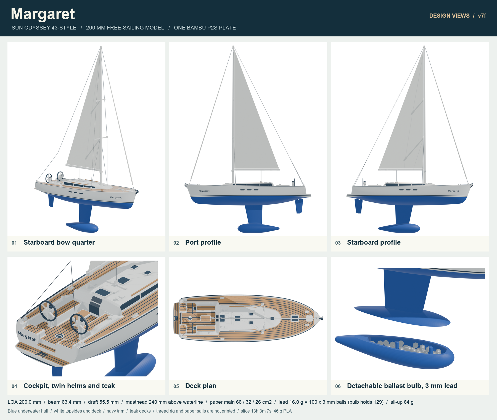

# 3d-design

3D-printable designs modelled in Blender (built by Python scripts, driven through the Blender MCP) and sliced for a Bambu Lab P2S.

| Project | What it is |
| --- | --- |
| [Margaret](Margaret/) | A 200 mm free-sailing model yacht in the style of a Jeanneau Sun Odyssey 43. It prints on one four-colour plate, has a detachable lead-ballast bulb and paper sails, and comes with a minimalist table stand. |

Each project folder has its own README covering printing, assembly and how to rebuild it from the scripts. Its `REVIEW.md` holds the multi-model design review log.
